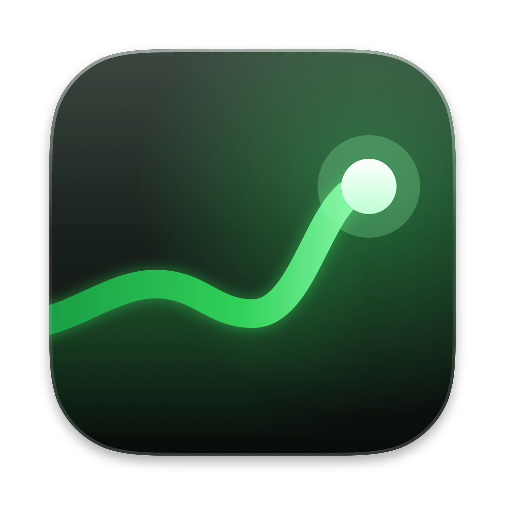
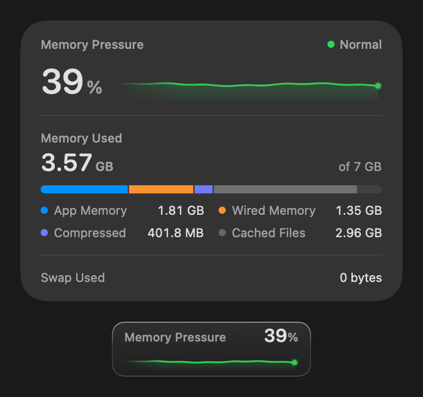
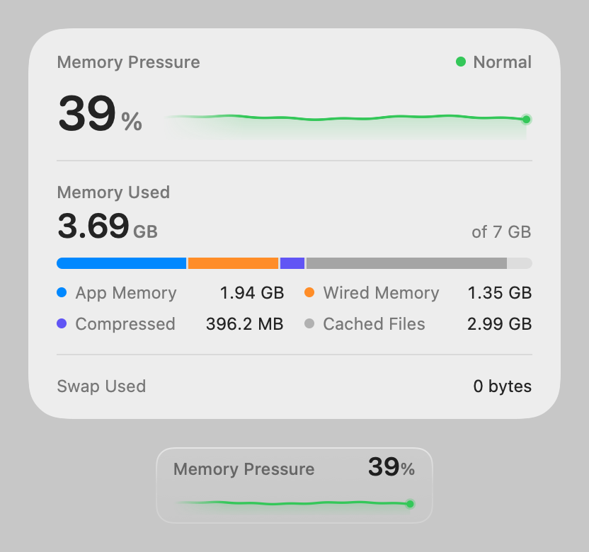

<p align="center">
  
</p>

<h1 align="center">Relay</h1>

<p align="center">
  Live memory pressure, right inside the macOS Dock.<br>
  <a href="https://github.com/umarfarooque88/relay/releases/latest"><b>Download Relay for macOS</b></a>
</p>


Relay puts a Liquid Glass bar in your Dock that shows memory pressure as a number and a running graph. Click the bar to open the full readout above it, with the same breakdown as Activity Monitor's memory footer. Relay has no window and no Dock icon of its own; the bar is all there is.

## The memory dock

<p align="center">
  
</p>
<p align="center">
  
</p>

- **The bar** sits on three blank spacer tiles at the right-hand end of the Dock. It follows the Dock as apps open and quit, and you can drag it to another spot.
- **The readout** rises from the bar when you click it:
  - **Memory Pressure**: percentage, level (Normal / Warning / Critical) and a 90-second graph
  - **Memory Used** out of installed memory, as one bar split into App Memory, Wired Memory, Compressed and Cached Files
  - **Swap Used**
- **Live**: Relay reads the kernel every 0.5 s and updates immediately when the pressure level changes.
- **Matches Activity Monitor**: the figures use the same formulas, checked against Activity Monitor on macOS 26.
- **Right-click menu**: Show or Hide Details, Open Activity Monitor, Open at Login, Remove from Dock, Quit.

## Install

Requires **macOS 26 (Tahoe)** or later. The app is a universal binary for Apple Silicon and Intel.

1. Download **Relay-1.0.zip** from the [latest release](https://github.com/umarfarooque88/relay/releases/latest) and unzip it.
2. Drag **Relay.app** into **Applications**.
3. Open it. Relay isn't notarized yet, so macOS blocks the first launch. To allow it, go to **System Settings › Privacy & Security** and click **Open Anyway**, or run this in Terminal:
   ```sh
   xattr -dr com.apple.quarantine /Applications/Relay.app
   ```
4. Relay then asks for two things:
   - **Add to Dock**: adds three blank spaces to the Dock and restarts it once.
   - **Accessibility access**: macOS only tells an app where Dock items are if the app has this permission. Turn on Relay under *Privacy & Security › Accessibility*.

If you decline either one, Relay waits in the corner of the screen, and both steps stay available in its right-click menu.

**Uninstall:** right-click the bar, choose **Remove from Dock and Quit…**, then delete Relay.app.

## Build from source

You need macOS 26 and Xcode 26 (Swift 6.2).

```sh
./build.sh          # builds build/Relay.app and build/Relay-1.0.zip
swift test          # runs the MemoryKit tests
```

`build.sh` builds a universal release binary, has the app draw its own icon into an `.icns`, wraps it all in an app bundle and signs it. If your keychain has a certificate named **Relay Local Signing**, it is used, which keeps the Accessibility permission across rebuilds; otherwise the app is signed ad hoc.

The binary also accepts some command-line flags:

| Flag | What it does |
| --- | --- |
| `--render-preview <png> [--light] [--high]` | Draws the bar and readout to an image (how the screenshots above were made) |
| `--render-icon <png>` | Draws the 1024 px app icon |
| `--open-at-login on\|off\|status` | Turns open at login on or off, or prints whether it's on |
| `--move-slot <x>` | Moves the Dock slot near screen position x |
| `--remove-slot` | Takes Relay's spacers out of the Dock |

## Releasing

Pushing a version tag builds the app on a macOS runner and publishes a GitHub Release with the zip and freshly rendered screenshots:

```sh
git tag v1.1 && git push origin v1.1
```

Update `CFBundleShortVersionString` in `build.sh` to match the tag.

## How it works

| Path | Role |
| --- | --- |
| `Sources/MemoryKit` | Reads memory statistics from the kernel (`host_statistics64`, `sysctl`) and turns them into Activity Monitor's figures. Has no UI, so it can be tested on its own. |
| `Sources/Relay/BarOverlay.swift` | The Dock bar: a borderless panel one level above the Dock, laid over the spacer slot |
| `Sources/Relay/DockLocator.swift` | Installs and removes the spacer slot, and finds it in the Dock through the Accessibility API |
| `Sources/Relay/DockPanel.swift`, `PanelView.swift` | The detail readout (SwiftUI on Liquid Glass) |
| `Sources/Relay/Sparkline.swift` | The pressure graph, drawn the same way in the bar and in the readout |
| `Sources/Relay/Setup.swift` | First-run prompts and open at login |
